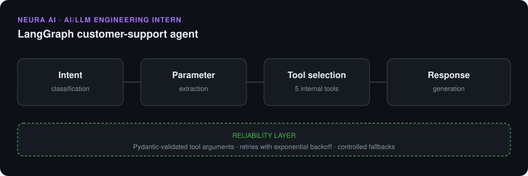

  

  

  
  
  
  

---

### 🚀 About me

- 🎓 Pre-final year B.E. Computer Science (AI/ML) at **The National Institute of Engineering, Mysore** (2023–2027)
- 🤖 Former **AI/LLM Engineering Intern at Neura AI**, building production LLM agents
- 🛠️ I build production-style systems: multi-tenant backends, real-time features, RAG pipelines, containerized deployments
- 🏆 2nd place in a college-wide DSA competition (Aug 2025) · Rank 11 / 800 on Codolio
- 💼 Looking for **fresher SDE / AI engineering roles and internships**

---

### 💼 Experience

#### 🤖 AI/LLM Engineering Intern · **Neura AI**

  

- Built a **LangGraph state machine** for a customer-support agent covering **intent classification → parameter extraction → tool selection → response generation**
- Integrated **5 internal tools** through **LLM function calling**
- Made agent execution reliable with **Pydantic-validated tool arguments**, **retries with exponential backoff** and **controlled fallbacks**

  
  
  
  

---

### 🧩 Featured projects

| Project | What it does | Stack |
|---|---|---|
| **[AI Interview Prep Platform](https://github.com/SATTURAMBOWORK/interview-platform)** | AI mock interviews, randomized MCQ tests and resume analysis, plus a custom C++ code judge running in isolated Docker containers | React · Node.js · MongoDB · Docker · Groq (Llama 3.3 70B) |
| **[AptHive](https://github.com/SATTURAMBOWORK/hive)** | Multi-tenant society management platform with 10+ modules and four-tier RBAC: visitor OTPs, amenity booking, SOS alerts, polls | MERN · Redis · Socket.IO · PM2 · Cloudinary |
| **[AI DevOps Incident Assistant](https://github.com/SATTURAMBOWORK/ai-devops-incident-assistant)** | Turns logs into structured root-cause analysis using RAG plus an ML classifier (84.9% test accuracy) | MERN · FastAPI · scikit-learn · Voyage AI · Groq · Docker · GitHub Actions |

<b>🔍 Engineering highlights</b>

**AptHive**
- Tenant isolation with `tenantId` carried in the JWT and enforced in middleware
- Race-free booking and voting: Redis distributed locks plus MongoDB compound unique indexes
- PM2 cluster mode with Redis for shared atomic counters and rate limiting (fixed window and sliding window log)
- Real-time SOS and force-logout over Socket.IO with tenant-level and per-user rooms
- Cache-aside with invalidate-on-write for read-heavy data

**AI Interview Prep Platform**
- Sandboxed code judge: user code is merged with driver code, compiled with `g++` inside Docker, and run against hidden test cases

**AI DevOps Incident Assistant**
- TF-IDF + Logistic Regression classifier: **84.9%** held-out accuracy, **81.8%** 5-fold CV, served via FastAPI
- LLM output constrained by a JSON schema and validated with Zod
- 4 services behind nginx with Docker Compose; CI runs tests, trains the model and pushes images to GHCR

---

### 🧠 LeetCode

  
  

---

### 🛠️ Tech stack

  

  
  
  
  
  

---

  

